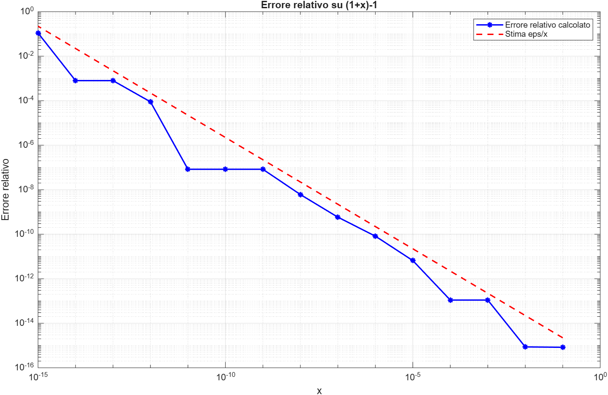
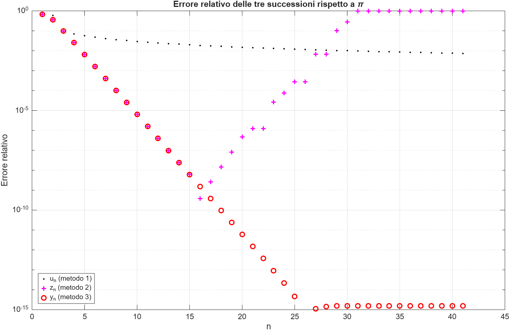
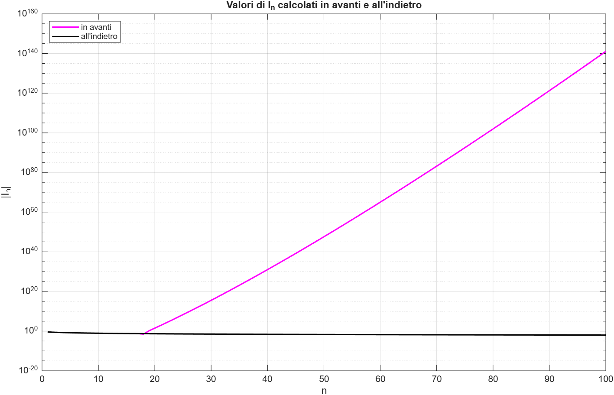

# 🧮 Laboratorio 1 — Aritmetica di macchina e instabilità degli algoritmi

> 📚 Corso di **Analisi Numerica** — Laurea Triennale in Intelligenza Artificiale e Data Analytics, Università di Trieste (A.A. 2026–2027)

In questo laboratorio si vede che **formule matematicamente equivalenti possono comportarsi in modo molto diverso al calcolatore**: colpa della rappresentazione finita dei numeri e di due fenomeni chiave, la **cancellazione numerica** e l'**amplificazione degli errori**.

---

## 📂 Struttura della cartella

| File | Descrizione |
|---|---|
| `radicesecgrado.m` | Radice di $x^2 + 2px - q = 0$ con formula classica e formula razionalizzata |
| `errori.m` | Errore relativo nel calcolo di $(1+x)-1$ per $x$ sempre più piccoli |
| `pigreco.m` | Tre successioni che convergono a $\pi$: una lenta, una instabile, una stabile |
| `succricorrente.m` | Successione $I_n$ calcolata in avanti (instabile) e all'indietro (stabile) |
| `img/` | Grafici generati dagli script (usati in questo README) 🖼️ |

---

## 🧠 Un minimo di teoria

### 🔢 Precisione di macchina
Un numero reale $x$ viene memorizzato come $\mathrm{fl}(x)$ con un errore relativo al più

$$
u = \frac{1}{2} B^{1-t}, \qquad B = 2,\ t = 53 \ \text{(IEEE-754 doppia precisione)}
$$

quindi $u \approx 1.11 \cdot 10^{-16}$. In MATLAB `eps` $= 2u \approx 2.22 \cdot 10^{-16}$.

### ➕ Propagazione degli errori
- **Prodotto e divisione** introducono un errore dell'ordine di $u$ ✅
- **Somma e sottrazione** no ⚠️:

$$
\varepsilon_{x+y} \le \left|\frac{x}{x+y}\right| \varepsilon_x + \left|\frac{y}{x+y}\right| \varepsilon_y
$$

  se $x \approx -y$ il denominatore è piccolissimo e l'errore esplode → **cancellazione numerica**.

### ⚖️ Stabilità
Un algoritmo è **stabile** se non amplifica gli errori (inevitabili) di rappresentazione, altrimenti è **instabile**. La stabilità dipende dall'**algoritmo**, non dal problema: per evitare la cancellazione si riscrive la formula in una forma equivalente ma numericamente migliore (es. **razionalizzazione**).

---

## 📝 Esercizi

### 1️⃣ Radice di un'equazione di secondo grado — `radicesecgrado.m`

🎯 **Problema:** calcolare la radice positiva di $x^2 + 2px - q = 0$ con $p = 1000$, $q = 0.018000000081$ (soluzione esatta $y = 9 \cdot 10^{-6}$).

| Algoritmo | Formula | Problema |
|---|---|---|
| ALG. 1 (classica) | $y = -p + \sqrt{p^2 + q}$ | sottrazione tra numeri quasi uguali ($p \gg q$) ❌ |
| ALG. 2 (razionalizzata) | $y = \dfrac{q}{p + \sqrt{p^2 + q}}$ | solo somme di positivi e una divisione ✅ |

📊 **Risultati:**

| | Valore | Errore relativo |
|---|---|---|
| ALG. 1 | 0.0000089999999773 | $2.52 \cdot 10^{-9}$ |
| ALG. 2 | 0.0000090000000000 | $0$ |

💡 **Lezione:** l'errore di arrotondamento su $\sqrt{p^2+q}$ (~$10^{-16}$) viene amplificato di circa $|\sqrt{p^2+q}|/|y| \approx 10^{8}$ volte → si perdono ~7 cifre significative. Razionalizzando la cancellazione sparisce.

---

### 2️⃣ Errore su $(1+x) - 1$ — `errori.m`

🎯 **Problema:** calcolare $(1+x)-1$ per $x = 10^{-1}, 10^{-2}, \dots, 10^{-15}$ e confrontarlo con il risultato esatto $x$.

📊 **Risultati (estratto):**

| $x$ | $(1+x)-1$ | Errore relativo |
|---|---|---|
| $10^{-1}$ | 1.000000000000001e-01 | $8.33 \cdot 10^{-16}$ |
| $10^{-6}$ | 9.999999999177334e-07 | $8.23 \cdot 10^{-11}$ |
| $10^{-9}$ | 1.000000082740371e-09 | $8.27 \cdot 10^{-8}$ |
| $10^{-12}$ | 1.000088900582341e-12 | $8.89 \cdot 10^{-5}$ |
| $10^{-15}$ | 1.110223024625157e-15 | $1.10 \cdot 10^{-1}$ |

💡 **Lezione:** $1+x$ viene arrotondato con un errore assoluto ~`eps`; sottraendo 1 l'errore assoluto resta, ma **relativamente a $x$** diventa

$$
\text{errore relativo} \lesssim \frac{\texttt{eps}}{x}
$$

A $x = 10^{-15}$ si sbaglia già dell'11%. Nel grafico `loglog` la curva sta sempre sotto la retta $\texttt{eps}/x$.



---

### 3️⃣ Tre successioni per $\pi$ — `pigreco.m`

🎯 **Problema:** calcolare $\pi$ con tre successioni (per $n = 2, \dots, 40$) e confrontarne l'errore relativo con `semilogy`.

| Successione | Formula | Comportamento |
|---|---|---|
| $u_n$ | $s_{n+1} = s_n + \dfrac{1}{(n+1)^2}$, $\quad u_{n+1} = \sqrt{6\, s_{n+1}}$ | 🐢 converge, ma **molto lentamente** |
| $z_n$ | $z_{n+1} = 2^{n-\frac12}\sqrt{1 - \sqrt{1 - 4^{1-n} z_n^2}}$ | 💥 **diverge** (cancellazione) |
| $y_n$ | $y_{n+1} = \dfrac{\sqrt{2}\, y_n}{\sqrt{1 + \sqrt{1 - 4^{1-n} y_n^2}}}$ | 🚀 converge **velocemente** |

($z_1 = y_1 = 1$, $z_2 = y_2 = 2$; $y_n$ si ottiene **razionalizzando** $z_n$.)

📊 **Risultati:**
- $u_n$: a $n = 41$ l'errore è ancora $7.35 \cdot 10^{-3}$
- $z_n$: minimo $3.88 \cdot 10^{-10}$ a $n = 16$, poi risale fino a errore $= 1$ ($z_n = 0$) da $n = 31$
- $y_n$: scende fino a $\approx 1.55 \cdot 10^{-15}$ e lì si stabilizza



💡 **Lezione:** $z_n$ e $y_n$ sono **analiticamente identiche** ma **numericamente diverse**. Per $n$ grande $c = 4^{1-n} z_n^2$ è minore della precisione di macchina, quindi $\sqrt{1-c} \to 1$ e $1 - \sqrt{1-c} \to 0$: cancellazione totale. Con $1 + \sqrt{1-c}$ al denominatore il problema non c'è.

---

### 4️⃣ Successione ricorrente $I_n$ — `succricorrente.m`

🎯 **Problema:** calcolare per $n = 1, \dots, 100$

$$
I_n = e^{-1} \int_0^1 x^n e^x \, dx
$$

sapendo che $I_n > 0$, è decrescente e $I_n \to 0$ come $1/n$. Integrando per parti si ottengono due ricorrenze **matematicamente equivalenti**:

| Verso | Formula | Partenza |
|---|---|---|
| ➡️ In avanti (`s`) | $I_{n+1} = 1 - (n+1)\, I_n$ | $I_1 = e^{-1}$ |
| ⬅️ All'indietro (`t`) | $I_{n-1} = \dfrac{1 - I_n}{n}$ | $I_{200} = 0$ |

📊 **Risultati:**

| $n$ | `s(n)` in avanti | `t(n)` all'indietro |
|---|---|---|
| 1 | 0.3679 | 0.3679 |
| 16 | 0.05546 | 0.05572 |
| 18 | **−0.02945** ❌ | 0.05012 |
| 25 | **1.93e+08** ❌ | 0.03709 |
| 100 | **≈ −1.16e+141** ❌ | 0.00980 |



💡 **Lezione:** chiamando $\varepsilon_n$ l'errore al passo $n$:
- **in avanti** $\varepsilon_n = -n\, \varepsilon_{n-1}$, quindi $|\varepsilon_n| = n!\, |\varepsilon_0|$ → il fattoriale **amplifica** l'errore iniziale (anche se è solo ~$10^{-17}$) 💥
- **all'indietro** $|\varepsilon_{m-k}| = \dfrac{|\varepsilon_m|}{m(m-1)\cdots(m-k+1)}$ → la produttoria **abbatte** l'errore iniziale, anche se $I_{200} = 0$ è un valore "sbagliato" ✅

---

## 🎯 Concetti chiave da ricordare

- 🔢 Ogni numero ha un errore relativo di rappresentazione fino a $u \approx 1.11 \cdot 10^{-16}$
- ➖ Sottrarre numeri **quasi uguali** amplifica l'errore relativo → **cancellazione numerica**
- 🔄 Formule equivalenti in matematica **non** lo sono al calcolatore
- 🛠️ Rimedio tipico: **riscrivere la formula** (razionalizzazione) per eliminare la sottrazione critica
- 📈 Nelle ricorrenze conta il **fattore di amplificazione**: se è $> 1$ ad ogni passo l'errore esplode, se è $< 1$ si smorza

---

## ▶️ Come eseguire

1. Apri MATLAB e imposta questa cartella come **Current Folder**
2. Lancia uno script dalla Command Window, ad esempio:

```matlab
>> radicesecgrado
>> errori
>> pigreco
>> succricorrente
```

Ogni script stampa i risultati in colonne e (dove previsto) apre i grafici. 📊