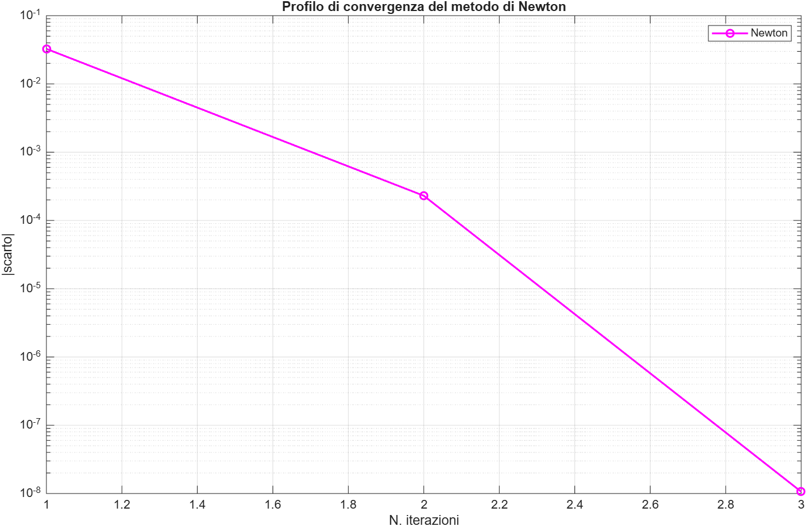
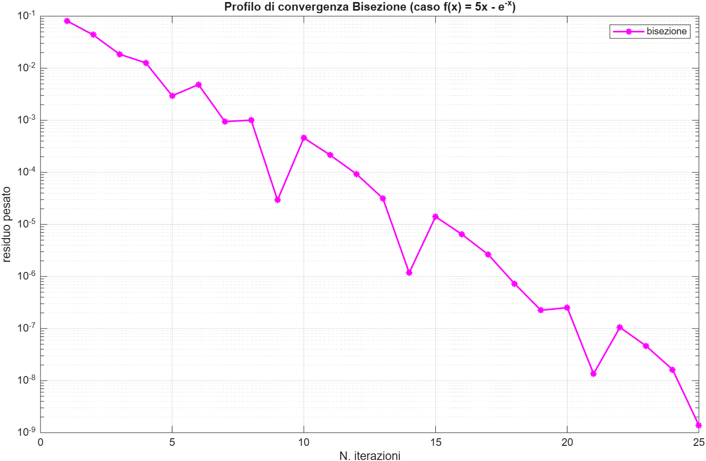
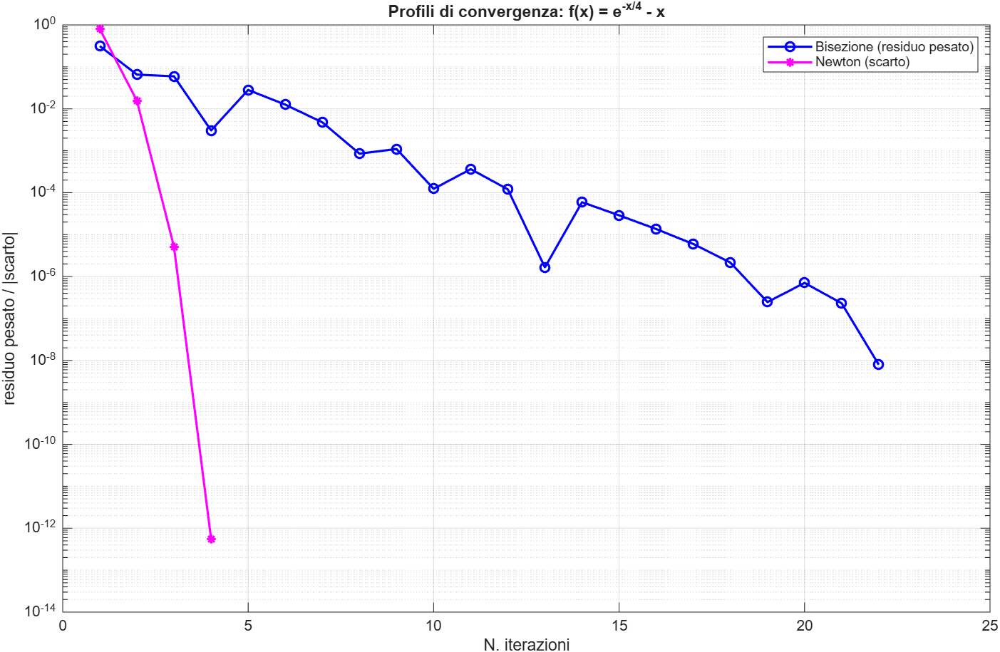
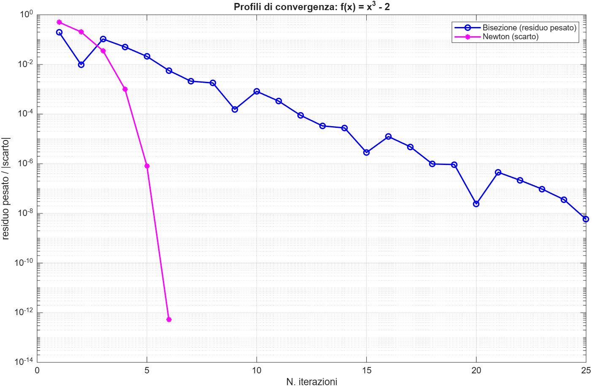
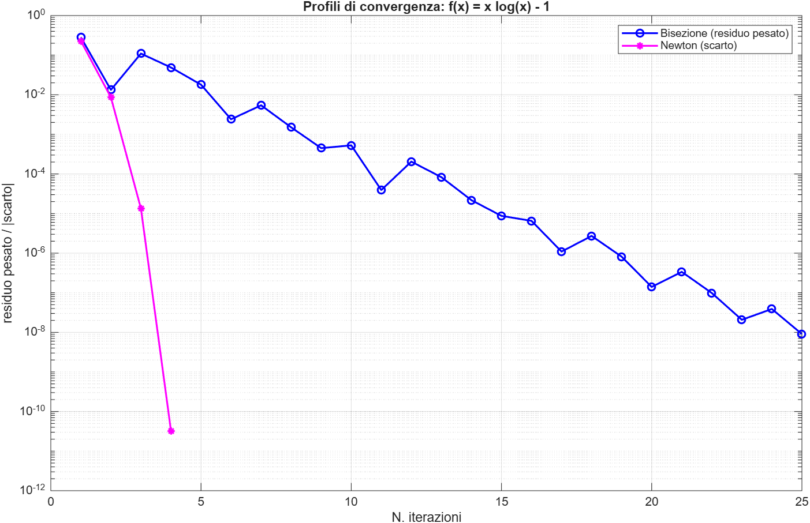
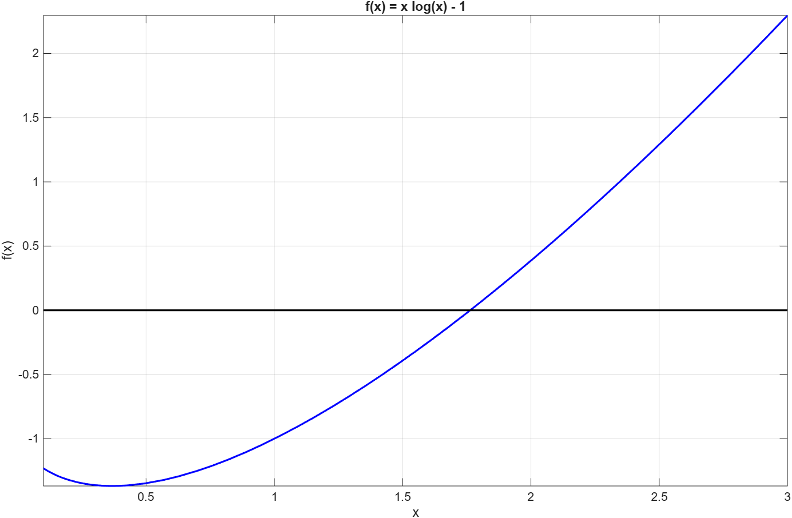
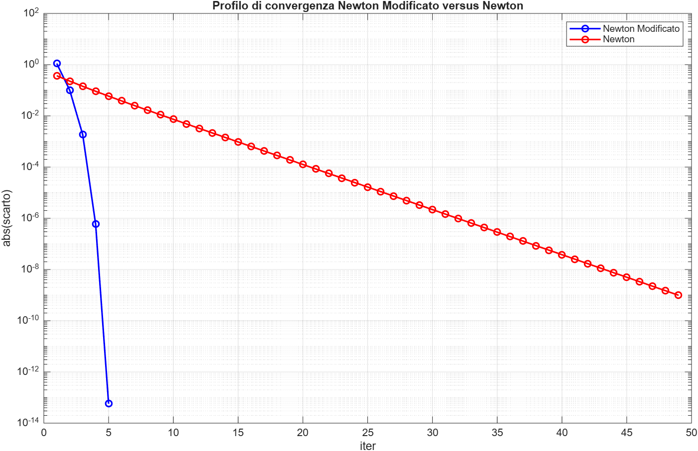

# 🔍 Laboratorio 2 — Equazioni non lineari

> 📚 Corso di **Analisi Numerica** — Laurea Triennale in Intelligenza Artificiale e Data Analytics, Università di Trieste (A.A. 2026–2027)

In questo laboratorio si risolvono equazioni del tipo $f(x) = 0$ con due **metodi iterativi**: la **bisezione** (lenta ma sicura) e il **metodo di Newton** (velocissimo, ma solo vicino alla radice). Alla fine si vede come recuperare la velocità di Newton anche per le **radici multiple**.

---

## 📂 Struttura della cartella

| File | Tipo | Descrizione |
|---|---|---|
| `bisezione.m` | ⚙️ function | Metodo di bisezione con criteri di arresto su semilunghezza e residuo pesato |
| `newton.m` | ⚙️ function | Metodo di Newton-Raphson |
| `newtonmod.m` | ⚙️ function | Metodo di Newton modificato per radici di molteplicità $r$ |
| `soluzione_aula_newton.m` | 📜 script | Esercizio d'aula: $e^{-2x} - x^2 = 0$ + dimostrazione errore ≈ precisione di macchina |
| `demonewton.m` | 📜 script | $\sqrt{2}$ con Newton |
| `demobisezione.m` | 📜 script | $\sqrt{2}$ con bisezione |
| `es_bisezione.m` | 📜 script | $5x = e^{-x}$ con bisezione + confronto con la stima delle iterazioni |
| `es_newton.m` | 📜 script | Radice maggiore di $x^2 - 5x + 6$ con Newton |
| `esproposto1.m` | 📜 script | $e^{-x/4} - x = 0$ con bisezione e Newton |
| `esproposto2.m` | 📜 script | $x^3 - 2 = 0$ con bisezione e Newton |
| `esproposto3.m` | 📜 script | $x \log x - 1 = 0$ con bisezione e Newton + intervallo di convergenza garantita |
| `scriptmod.m` | 📜 script | Newton vs Newton modificato su $(x-1)^2 \log x$ |
| `risultati_esproposto*.txt` | 📄 output | Risultati degli esercizi proposti scritti su file |
| `img/` | 🖼️ output | Grafici generati dagli script (usati in questo README) |

> ⚠️ Le function (`bisezione.m`, `newton.m`, `newtonmod.m`) **non si lanciano da sole**: vengono chiamate dagli script, che passano loro gli input.

---

## 🧠 Un minimo di teoria

### 📏 Ordine di convergenza
Sia $e_k = x_k - \alpha$ l'errore al passo $k$. Se esistono $p > 0$ e $C \neq 0$ tali che

$$
\lim_{k \to \infty} \frac{|e_{k+1}|}{|e_k|^p} = C
$$

allora $p$ è l'**ordine di convergenza**: $p = 1$ **lineare**, $p = 2$ **quadratica**.

### ✂️ Metodo di bisezione
Se $f$ è continua e $f(a) \cdot f(b) < 0$, si prende il punto medio $c = \frac{a+b}{2}$ e si tiene la metà dell'intervallo in cui $f$ cambia segno.

- ✅ **Converge sempre** (usa solo il segno di $f$)
- 🐢 Guadagna circa **un bit per iterazione** (l'intervallo si dimezza)
- 🔢 Per avere errore $< \varepsilon$ servono al più

$$
n = \left\lceil \log_2 \frac{b - a}{\varepsilon} \right\rceil - 1 \quad \text{iterazioni}
$$

🛑 **Criteri di arresto:**
- semilunghezza $\frac{1}{2}|b_k - a_k| \le \varepsilon$ (sicuro: è un limite superiore dell'errore)
- **residuo pesato** $|f(c) \cdot w| \le \varepsilon$, con $w = \left(\frac{f(b) - f(a)}{b - a}\right)^{-1}$

Il residuo pesato stima l'errore perché, da Taylor, $|e| \approx \left|\frac{f(c)}{f'(c)}\right|$. Il semplice residuo $|f(c)|$ invece non è affidabile per funzioni molto **piatte** o molto **ripide**.

### 📐 Metodo di Newton
Se $f$ è derivabile e $f'(x) \neq 0$:

$$
x_{k+1} = x_k - \frac{f(x_k)}{f'(x_k)}
$$

📐 **Idea geometrica:** $x_{k+1}$ è il punto in cui la **retta tangente** a $f$ in $x_k$ taglia l'asse $x$. Per questo serve $f'(x_k) \neq 0$ (una tangente orizzontale non taglia mai l'asse), e se $f$ è convessa e si parte dal lato giusto le tangenti non scavalcano la radice.

- 🚀 Se $\alpha$ è uno zero **semplice** ($f'(\alpha) \neq 0$) la convergenza è **quadratica**: $|e_{k+1}| \approx C |e_k|^2$ con $C = \left|\frac{f''(\alpha)}{2 f'(\alpha)}\right|$
- ⚠️ La convergenza è solo **locale**: $x_0$ deve essere abbastanza vicino ad $\alpha$
- 🛑 Criterio di arresto sullo **scarto**: $|x_{k+1} - x_k| < \texttt{tol}$, perché $x_{k+1} - x_k \approx -e_k$
- 💡 Se $f(x_0) \cdot f''(x_0) > 0$ la convergenza è **monotona** (non scavalca la radice)

### 🔁 Radici multiple e Newton modificato
Se $\alpha$ ha **molteplicità** $r > 1$ (cioè $f(\alpha) = f'(\alpha) = \dots = f^{(r-1)}(\alpha) = 0$), Newton converge solo **linearmente**, con costante $\frac{r-1}{r}$. Il **Newton modificato** ripristina la convergenza quadratica:

$$
x_{k+1} = x_k - r \, \frac{f(x_k)}{f'(x_k)}
$$

---

## ⚙️ Le function

| Function | Chiamata | Output |
|---|---|---|
| `bisezione` | `[vc, k, semilun, respesato] = bisezione(a, b, tolintv, tolres, maxit, f)` | punti medi, n. iterazioni, semilunghezze, residui pesati |
| `newton` | `[x, iter, scarti] = newton(f, df, x0, tol, itmax)` | approssimazioni (con `x(1) = x0`), n. iterazioni, scarti |
| `newtonmod` | `[x, iter, scarti] = newtonmod(f, df, x0, tol, itmax, r)` | come `newton`; con `r = 1` coincide con Newton classico |

🛠️ Rispetto al codice delle slide, `bisezione.m` ha due correzioni:
1. se $f(a) = 0$ o $f(b) = 0$ restituisce `vc` (nelle slide c'era `c`, che non è un output → errore)
2. controlla che $f(a)$ e $f(b)$ abbiano **segno opposto** prima di iniziare

---

## 📝 Esercizi

### 1️⃣ Esercizio d'aula: $e^{-2x} - x^2 = 0$ — `soluzione_aula_newton.m`

🎯 Newton con $x_0 = 0.6$, $\texttt{tol} = 10^{-7}$.

| $k$ | $x_k$ | scarto $s_k$ |
|---|---|---|
| 1 | 0.600000000000000 | – |
| 2 | 0.567373410020566 | $-3.26 \cdot 10^{-2}$ |
| 3 | 0.567143301040812 | $-2.30 \cdot 10^{-4}$ |
| 4 | 0.567143290409784 | $-1.06 \cdot 10^{-8}$ |

🧪 **Dimostrazione: l'errore relativo dell'ultima approssimazione è pari alla precisione di macchina.**
1. Lo scarto approssima l'errore precedente: $|e_3| \approx |s_3| = 1.06 \cdot 10^{-8}$
2. Convergenza quadratica con $C = \left|\frac{f''(\alpha)}{2f'(\alpha)}\right| \approx 0.2$:

$$
|e_4| \approx C\,|e_3|^2 \approx 0.2 \cdot (1.06 \cdot 10^{-8})^2 \approx 2.3 \cdot 10^{-17} \quad\Rightarrow\quad \frac{|e_4|}{\alpha} \approx 4 \cdot 10^{-17} < u
$$

3. Il contributo di Newton è sotto la precisione di macchina: resta solo l'errore di **arrotondamento**. Verifica numerica: un passo in più sposta $x_4$ di **un solo numero di macchina** (scarto relativo $1.96 \cdot 10^{-16} \approx$ `eps`) e il residuo è $|f(x_4)| \approx 1.7 \cdot 10^{-16}$.



---

### 2️⃣ $\sqrt{2}$ con i due metodi — `demonewton.m`, `demobisezione.m`

🎯 Zero positivo di $f(x) = x^2 - 2$.

| Metodo | Parametri | Iterazioni | Errore relativo finale |
|---|---|---|---|
| Newton | $x_0 = 1$, $\texttt{tol} = 10^{-8}$ | **5** | $0$ |
| Bisezione | $[1, 2]$, $\texttt{tol} = 10^{-15}$ | **48** | $4.71 \cdot 10^{-16}$ |

💡 Stessa precisione, ma **5 contro 48** iterazioni: quadratica vs lineare. Nella bisezione l'errore **non** decresce in modo monotono (ci sono "colpi di fortuna" in cui il punto medio cade vicinissimo a $\sqrt{2}$), per questo non ha un ordine di convergenza in senso stretto.

---

### 3️⃣ $5x = e^{-x}$ con bisezione — `es_bisezione.m`

🎯 $f(x) = 5x - e^{-x}$ è strettamente crescente ($f'(x) = 5 + e^{-x} > 0$) → **una sola radice**. Dal grafico: $[a, b] = [0, 0.5]$, $\varepsilon = 10^{-8}$.

| | Valore |
|---|---|
| Soluzione | $\alpha \approx 0.168915972$ |
| Iterazioni eseguite | **25** |
| Iterazioni stimate $\lceil \log_2 \frac{0.5}{10^{-8}} \rceil - 1$ | **25** ✅ |

💡 Al passo 25 la semilunghezza ($1.49 \cdot 10^{-8}$) è ancora sopra la tolleranza: a fermare il metodo è il **residuo pesato** ($1.39 \cdot 10^{-9}$).



---

### 4️⃣ Radice maggiore di $x^2 - 5x + 6$ con Newton — `es_newton.m`

🎯 Radici $2$ e $3$, vertice in $x = 2.5$ dove $f'(2.5) = 0$.
- $x_0 < 2.5$ → converge a **2**; $x_0 > 2.5$ → converge a **3**; $x_0 = 2.5$ → **derivata nulla** ❌
- Scelta: $x_0 = 4$ (a destra della radice, $f$ convessa → discesa **monotona**)

📊 **6 iterazioni**, errore finale $0$. Qui $C = \left|\frac{f''(3)}{2f'(3)}\right| = 1$, quindi ogni errore è circa il **quadrato** del precedente: $3.9 \cdot 10^{-3} \to 1.5 \cdot 10^{-5} \to 2.3 \cdot 10^{-10}$.

---

### 5️⃣ Esercizi proposti — `esproposto1.m`, `esproposto2.m`, `esproposto3.m`

🎯 Per ogni equazione: grafico, scelta di $[a, b]$ e $x_0$, bisezione e Newton con $\texttt{tol} = 10^{-8}$, stampa a video **e su file** (`risultati_esproposto*.txt`), profili di convergenza sullo stesso grafico.

| Equazione | $[a, b]$ | $x_0$ | Bisezione (stima) | Newton | Radice $\alpha$ |
|---|---|---|---|---|---|
| $e^{-x/4} - x = 0$ | $[0, 1]$ | $0$ | 22 (26) | **4** | 0.815553418808961 |
| $x^3 - 2 = 0$ | $[1, 2]$ | $2$ | 25 (26) | **6** | 1.259921049894873 |
| $x \log x - 1 = 0$ | $[1, 2]$ | $2$ | 25 (26) | **4** | 1.763222834351897 |

💡 Osservazioni:
- 🚀 Newton è sempre **4–6 volte più veloce** della bisezione
- 🛑 La bisezione si ferma sempre **prima della stima**, grazie al residuo pesato, e rispetta comunque la tolleranza (es. per $x^3 - 2$ l'errore vero è $5.78 \cdot 10^{-9}$, identico all'ultimo residuo pesato)
- ✍️ Per scrivere a video e su file con lo stesso codice: `for dest = [1, fid]` → `fprintf(dest, ...)` (`1` = Command Window, `fid` = file aperto con `fopen`)

**Equazione 1:** $e^{-x/4} - x = 0$



**Equazione 2:** $x^3 - 2 = 0$



**Equazione 3:** $x \log x - 1 = 0$, $x > 0$



#### 🎯 Intervallo di convergenza garantita per Newton (equazione 3)
Con $f'(x) = \log x + 1$ (nulla in $x = 1/e \approx 0.368$) e $f''(x) = 1/x > 0$, su $[a, b] = [1, 2]$ valgono:
1. $f(1) \cdot f(2) < 0$ → la radice è dentro
2. $f'(x) \ge 1 > 0$ → derivata mai nulla
3. $f''(x) > 0$ → concavità costante
4. $\left|\frac{f(1)}{f'(1)}\right| = 1 \le b - a$ e $\left|\frac{f(2)}{f'(2)}\right| \approx 0.228 \le b - a$ → il primo passo non esce dall'intervallo

⇒ **Newton converge per ogni $x_0 \in [1, 2]$** ✅ (verificato con 11 punti iniziali: tutti arrivano ad $\alpha$ in 4–5 iterazioni).
❌ Controesempio: $x_0 = 0.3 < 1/e$ → $x_1 \approx -6.37$, fuori dal dominio $x > 0$.



---

### 6️⃣ Radici multiple: Newton vs Newton modificato — `scriptmod.m`

🎯 $f(x) = (x-1)^2 \log x$ in $[1, 3]$, $x_0 = 2$, $\texttt{tol} = 10^{-9}$.
Vicino a $x = 1$ vale $\log x \approx x - 1$, quindi $f(x) \approx (x-1)^3$ → radice di **molteplicità $r = 3$**.

| | Newton ($r = 1$) | Newton modificato ($r = 3$) |
|---|---|---|
| Iterazioni | **49** | **5** |
| Soluzione | 1.000000001971346 | 1.000000000000000 |
| Convergenza | 🐢 lineare | 🚀 quadratica |
| Rapporto scarti `abs(s_k / s_(k-1))` | $0.6667 = \frac{r-1}{r}$ ✅ | – |

💡 Vicino a una radice multipla $f$ e $f'$ tendono a zero **insieme**: il passo $f/f'$ è "troppo corto" di un fattore $r$. Moltiplicarlo per $r$ lo corregge. Nel grafico la curva rossa è una **retta** (lineare), quella blu **precipita** (quadratica).



---

## 🎯 Concetti chiave da ricordare

- ✂️ **Bisezione:** converge sempre se $f(a) f(b) < 0$, ma lentamente (lineare, ~1 bit per passo); numero di iterazioni prevedibile a priori
- 📐 **Newton:** convergenza **quadratica** per zeri semplici, ma solo **locale** → il grafico di $f$ serve per scegliere bene $x_0$
- 🚫 Mai partire da un punto con $f'(x_0) = 0$ (tangente orizzontale)
- 🧭 Se $f(x_0) f''(x_0) > 0$ Newton converge in modo **monotono**
- 🛑 Criteri di arresto: **scarto** per Newton, **semilunghezza** e **residuo pesato** per la bisezione; il residuo $|f(c)|$ da solo non è affidabile
- 🔁 Radice di molteplicità $r$ → Newton diventa **lineare** (costante $\frac{r-1}{r}$); **Newton modificato** ripristina la convergenza quadratica
- 🔢 Quando lo scarto stimato scende sotto la precisione di macchina, l'errore che resta è solo di **arrotondamento** (~`eps`)

---

## ▶️ Come eseguire

1. Apri MATLAB e imposta questa cartella come **Current Folder** (le function devono stare nella stessa cartella degli script)
2. Lancia uno script dalla Command Window, ad esempio:

```matlab
>> soluzione_aula_newton
>> es_bisezione
>> esproposto3
>> scriptmod
```

Ogni script stampa i risultati in colonne, apre i grafici e salva le immagini in `img/` 📊. Gli esercizi proposti scrivono anche i risultati in `risultati_esproposto*.txt` 📄. 📄.