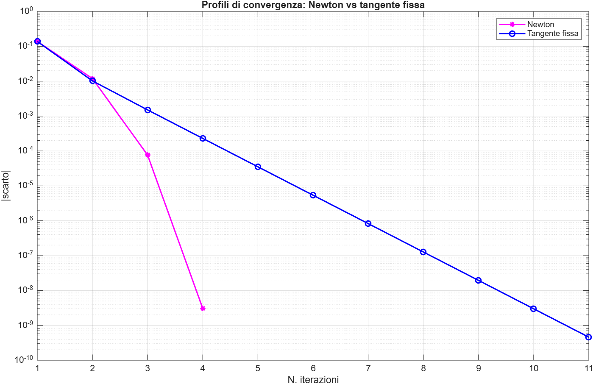
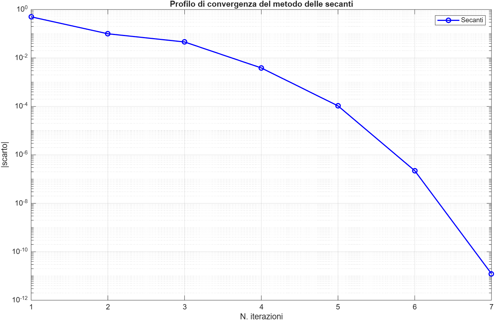
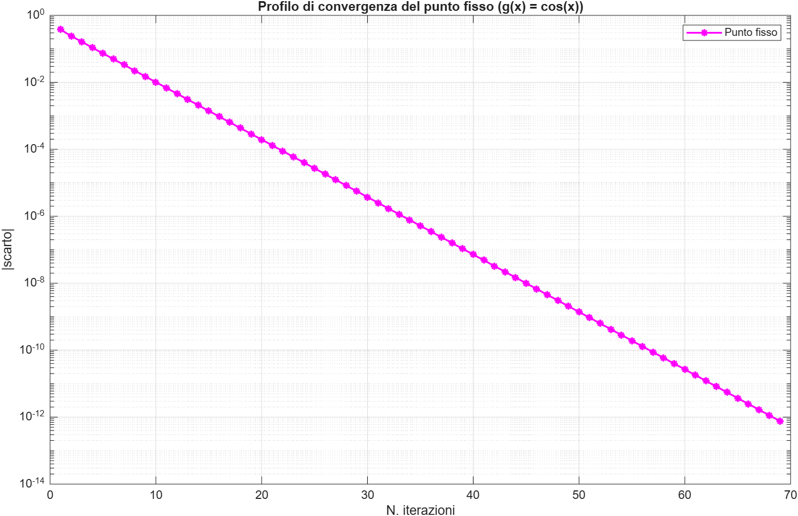
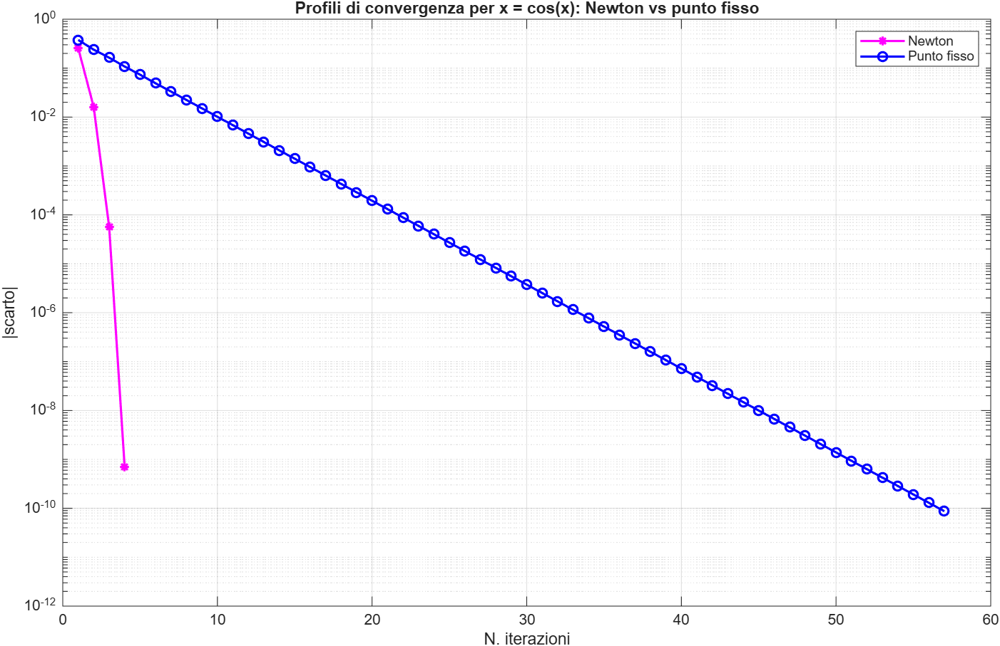
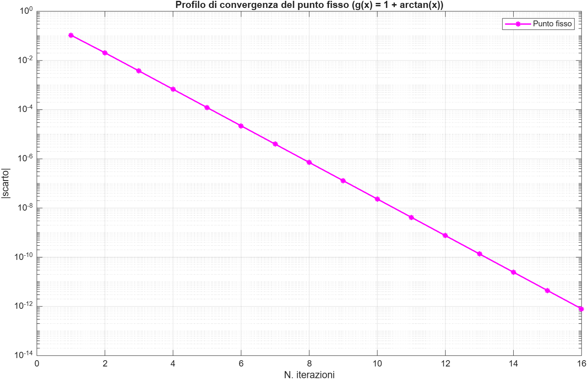

# 🔁 Laboratorio 3 — Tangente fissa, secanti e punto fisso

> 📚 Corso di **Analisi Numerica** — Laurea Triennale in Intelligenza Artificiale e Data Analytics, Università di Trieste (A.A. 2026–2027)

In questo laboratorio si risolvono equazioni $f(x) = 0$ con tre **varianti del metodo di Newton**: la **tangente fissa** (la derivata si calcola una volta sola), le **secanti** (la derivata non serve proprio) e il **punto fisso** ($x = g(x)$). Ogni metodo viene confrontato con Newton per vedere quanto si perde in velocità e cosa si guadagna in semplicità.

> 📌 Il PDF del laboratorio è una guida completa: le slide 1–25 (bisezione, Newton, Newton modificato) sono già svolte nel **Laboratorio 2**. Qui ci sono solo le slide 26–40.

---

## 📂 Struttura della cartella

| File | Tipo | Descrizione |
|---|---|---|
| `newton.m` | ⚙️ function | Metodo di Newton-Raphson (dal Lab 2, con in più il controllo `fx == 0`) |
| `tfissa.m` | ⚙️ function | Metodo della tangente fissa |
| `secvariabile.m` | ⚙️ function | Metodo delle secanti (secante variabile) |
| `pfisso.m` | ⚙️ function | Metodo di punto fisso |
| `script_tfissa.m` | 📜 script | $e^{-x} + \cos x - 3 = 0$: Newton vs tangente fissa |
| `script_secanti.m` | 📜 script | $e^{-x} + \cos x - 3 = 0$ con le secanti + stima dell'ordine $p$ |
| `script_pfisso.m` | 📜 script | $x = \cos x$ con il punto fisso + stima di $C$ nei due modi + scrittura su file |
| `script_confronto.m` | 📜 script | $x = \cos x$: Newton vs punto fisso |
| `script_arctan.m` | 📜 script | $x = 1 + \arctan x$ con il punto fisso + verifica delle ipotesi + scrittura su file |
| `risultati_script_*.txt` | 📄 output | Risultati del punto fisso scritti su file |
| `img/` | 🖼️ output | Grafici generati dagli script (usati in questo README) |

> ⚠️ Le function **non si lanciano da sole**: vengono chiamate dagli script, che passano loro gli input.

---

## 🧠 Un minimo di teoria

### 📏 Ordine di convergenza (ripasso)
Con $e_k = x_k - \alpha$, se $|e_{k+1}| \approx C\,|e_k|^p$ allora $p$ è l'**ordine** e $C$ la **costante asintotica**. In pratica si stimano con gli **scarti** $s_k = x_k - x_{k-1}$:

- $p = 1$ (**lineare**): il rapporto `abs(s_k / s_(k-1))` tende a $C$ → nel grafico semilogaritmico gli scarti formano una **retta**
- $p > 1$: la retta diventa **sempre più ripida** (le cifre corrette si moltiplicano per $p$ a ogni passo)

### 📐 Tangente fissa
$$
x_{k+1} = x_k - \frac{f(x_k)}{f'(x_0)}
$$

Come Newton, ma la pendenza è **sempre quella in $x_0$**: si calcola $f'$ una volta sola. Il prezzo è la convergenza **lineare**, con

$$
C = \left|1 - \frac{f'(\alpha)}{f'(x_0)}\right|
$$

💡 Più $f'(x_0)$ è vicina a $f'(\alpha)$, più $C$ è piccolo e il metodo è veloce.

### ✂️ Secanti
$$
x_{k+1} = x_k - \frac{f(x_k)}{h_k}, \qquad h_k = \frac{f(x_k) - f(x_{k-1})}{x_k - x_{k-1}} \approx f'(x_k)
$$

La tangente è sostituita dalla **secante** per gli ultimi due punti: **non serve $f'$**, ma servono **due** punti iniziali $x_0, x_1$. Convergenza **superlineare**:

$$
p = \frac{1 + \sqrt5}{2} \approx 1.618, \qquad C = \left|\frac{f''(\alpha)}{2f'(\alpha)}\right|^{0.618}
$$

### 🎯 Punto fisso
Si riscrive $f(x) = 0$ come $x = g(x)$ e si itera $x_{k+1} = g(x_k)$. Geometricamente $\alpha$ è l'**intersezione** tra $y = g(x)$ e la **bisettrice** $y = x$.

✅ **Convergenza garantita** se esiste $[a, b]$ con:
1. $g([a, b]) \subseteq [a, b]$ (l'intervallo viene mandato in sé stesso)
2. `abs(g'(x)) < 1` su $[a, b]$ (**contrazione**)

🐢 La convergenza è **lineare** con $C = |g'(\alpha)|$, e il **segno** di $g'(\alpha)$ decide come ci si avvicina ad $\alpha$:

| $g'(\alpha)$ | Iterate | Scarti | Errore residuo dopo l'ultimo scarto $s$ |
|---|---|---|---|
| $> 0$ | monotone (sempre dallo stesso lato) | stesso segno | circa `C/(1-C) * abs(s)` |
| $< 0$ | rimbalzano attorno ad $\alpha$ | segno alterno | circa `C/(1+C) * abs(s)` |

🔢 Poiché `abs(s_k)` vale circa `abs(s_1) * C^(k-1)`, il numero di iterazioni si può **prevedere**:

$$
k \approx \frac{\log(\texttt{tol} / |s_1|)}{\log C} + 1
$$

---

## ⚙️ Le function

| Function | Chiamata | Output |
|---|---|---|
| `newton` | `[x, iter, scarti] = newton(f, df, x0, tol, itmax)` | approssimazioni (con `x(1) = x0`), n. iterazioni, scarti con segno |
| `tfissa` | `[x, iter, scarti] = tfissa(f, df, x0, tol, itmax)` | come `newton`; `df` viene valutata solo in `x0` |
| `secvariabile` | `[x, iter, scarti] = secvariabile(f, x0, x1, tol, itmax)` | approssimazioni (con `x(1) = x0`, `x(2) = x1`), n. iterazioni, scarti (il primo è `x1 - x0`) |
| `pfisso` | `[xvec, iter, scarti] = pfisso(g, x0, tol, itmax)` | approssimazioni (con `xvec(1) = x0`), n. iterazioni, scarti con segno |

🛠️ Correzioni rispetto alle slide:
1. **Slide 30:** gli input di `secvariabile` erano solo `f, x0, itmax, tol`, ma per la prima secante serve anche **`x1`** → aggiunto
2. **Slide 37–38:** la 37 legge l'ultima iterata con `xvec(iter)`, la 38 usa `xvec(2:end)` (cioè assume `x0` come primo elemento): le due slide sono incoerenti. Con la convenzione `xvec(1) = x0` l'ultima iterata è **`xvec(end)`**
3. **Slide 18:** gli scarti erano descritti "in valore assoluto", la slide 26 li definisce con segno → li salviamo **con segno** (il segno dice da che parte si arriva ad $\alpha$)
4. **`newton.m`:** rispetto al Lab 2 si ferma se $f(x_k) = 0$ esattamente. Senza questo controllo si avrebbe uno scarto nullo (che `semilogy` non può disegnare) e, su una radice multipla, un falso errore di derivata nulla

---

## 📝 Esercizi

### 1️⃣ Newton vs tangente fissa — `script_tfissa.m`

🎯 $f(x) = e^{-x} + \cos x - 3$, $x_0 = -1$, $\texttt{tol} = 10^{-9}$ (slide 27).
- Per $x > 0$ vale $f < 0$; per $x < 0$ vale $f' = -e^{-x} - \sin x < 0$ → **una sola radice**, $\alpha \approx -0.8502$
- $f(x_0) \approx 0.26 > 0$ e $f''(x_0) = e - \cos 1 > 0$ → Newton converge in modo **monotono**

| $k$ | Newton $x_k$ | scarto $s_k$ | Tangente fissa $x_k$ | scarto $s_k$ |
|---|---|---|---|---|
| 1 | -1.000000000000000 | – | -1.000000000000000 | – |
| 2 | -0.862221525838941 | $1.38 \cdot 10^{-1}$ | -0.862221525838941 | $1.38 \cdot 10^{-1}$ |
| 3 | -0.850309070491093 | $1.19 \cdot 10^{-2}$ | -0.852008112639104 | $1.02 \cdot 10^{-2}$ |
| 4 | -0.850232919483943 | $7.62 \cdot 10^{-5}$ | -0.850503961399163 | $1.50 \cdot 10^{-3}$ |
| 5 | -0.850232916416951 | $3.07 \cdot 10^{-9}$ | -0.850274483530718 | $2.29 \cdot 10^{-4}$ |
| … | | | … | … |
| 11 | | | -0.850232916960201 | $3.00 \cdot 10^{-9}$ |
| 12 | | | -0.850232916500329 | $4.60 \cdot 10^{-10}$ |

| | Newton | Tangente fissa |
|---|---|---|
| Soluzione | -0.850232916416951 | -0.850232916500329 |
| Iterazioni | **4** | **11** |
| $C$ stimata | 0.5289 | 0.1535 |
| $C$ teorica | 0.5288 | 0.1535 |

💡 Osservazioni:
- 🔁 Il **primo passo è identico** nei due metodi: alla prima iterazione la tangente fissa *è* la tangente di Newton
- 🛑 Newton si ferma con scarto $3.07 \cdot 10^{-9}$ (ancora sopra `tol`) perché $f(x_5) = 0$ **esattamente** in aritmetica di macchina: è il controllo `fx == 0`
- 📏 Le due soluzioni differiscono di $8.3 \cdot 10^{-11}$, che è proprio l'errore residuo della tangente fissa: scarti tutti dello stesso segno → `C/(1-C) * abs(s) = 0.1535/0.8465 * 4.60e-10 = 8.3e-11`



---

### 2️⃣ Metodo delle secanti — `script_secanti.m`

🎯 Stessa $f$, $x_0 = -1.5$, $x_1 = -1$, $\texttt{tol} = 10^{-10}$ (slide 30).

| $k$ | $x_k$ | scarto $s_k$ |
|---|---|---|
| 1 | -1.500000000000000 | – |
| 2 | -1.000000000000000 | $5.00 \cdot 10^{-1}$ |
| 3 | -0.900071219356351 | $9.99 \cdot 10^{-2}$ |
| 4 | -0.854218593905180 | $4.59 \cdot 10^{-2}$ |
| 5 | -0.850338378648600 | $3.88 \cdot 10^{-3}$ |
| 6 | -0.850233138782927 | $1.05 \cdot 10^{-4}$ |
| 7 | -0.850232916429353 | $2.22 \cdot 10^{-7}$ |
| 8 | -0.850232916416951 | $1.24 \cdot 10^{-11}$ |

| | Stimato | Teorico |
|---|---|---|
| Ordine $p$ | 1.5900 | 1.6180 |
| Costante $C$ | 0.7214 | 0.6745 |

💡 **6 iterazioni** e la stessa soluzione di Newton, cifra per cifra, **senza mai calcolare $f'$**. Gli esponenti degli scarti (−2.4 → −4.0 → −6.7 → −10.9) si moltiplicano per circa **1.6** a ogni passo: è l'ordine superlineare. La stima di $C$ è meno precisa di quella di $p$ perché, con così pochi passi, il regime asintotico è appena iniziato.

📌 Nel grafico i punti sono 7 per 6 iterazioni: il primo è `x1 - x0`, la distanza tra i due punti iniziali.



---

### 3️⃣ Punto fisso per $x = \cos x$ — `script_pfisso.m`

🎯 $g(x) = \cos x$, $x_0 = 0.5$, $\texttt{tol} = 10^{-12}$ (slide 36–38). $C$ stimata nei due modi della slide 35: `asint1` = rapporto tra scarti consecutivi, `asint2` = `abs(g'(x_k))`.

| | Ottenuto | Slide 37 |
|---|---|---|
| Soluzione `xvec(end)` | 0.739085133215467 | 0.739085133215467 ✅ |
| Iterazioni | **69** | 69 ✅ |
| Iterazioni stimate con $C$ | **69** | – |
| Ultimo scarto | $7.6106 \cdot 10^{-13}$ | $7.6106 \cdot 10^{-13}$ ✅ |
| `asint1(end)` / `asint2(end)` | 0.6736 / 0.6736 | 0.6736 / 0.6736 ✅ |

💡 $g'(\alpha) = -\sin\alpha < 0$ → gli scarti **alternano il segno** (0.878 → 0.639 → 0.803 → …: le iterate rimbalzano attorno ad $\alpha$). Con $C = 0.67$ vicino a 1 servono circa **6 passi per ogni cifra decimale**: il profilo è una retta poco inclinata.



---

### 4️⃣ Newton vs punto fisso per $x = \cos x$ — `script_confronto.m`

🎯 Newton su $f(x) = x - \cos x$ ($f' = 1 + \sin x$), punto fisso su $g(x) = \cos x$, stesso $x_0 = 0.5$, $\texttt{tol} = 10^{-10}$ (slide 39).
Scelta di $x_0$: su $[0.5, 1]$ il punto fisso converge sempre (`abs(g') <= sin(1) = 0.84`), e per Newton $f' > 0$ non si annulla mai. Con $x_0 = 0.5 < \alpha$ il primo passo di Newton **scavalca** $\alpha$ (0.5 → 0.755), poi scende in modo monotono.

| | Newton | Punto fisso |
|---|---|---|
| Soluzione | 0.739085133215161 | 0.739085133250253 |
| Iterazioni | **4** | **57** |
| $C$ stimata | 0.2208 | 0.6736 |
| $C$ teorica | 0.2208 | 0.6736 |

💡 Osservazioni:
- 🚀 Newton è circa **14 volte più rapido** (come nell'esercizio 1, si ferma per `fx == 0`)
- 🔢 57 iterazioni contro le 69 dell'esercizio 3: due cifre in meno di tolleranza × circa 6 passi per cifra = 12 iterazioni in meno
- 📏 Differenza tra le soluzioni: $3.51 \cdot 10^{-11}$, cioè l'errore del punto fisso. Qui gli scarti alternano il segno → `C/(1+C) * abs(s) = 0.6736/1.6736 * 8.72e-11 = 3.51e-11` ✅



---

### 5️⃣ Punto fisso per $x = 1 + \arctan x$ — `script_arctan.m`

🎯 $g(x) = 1 + \arctan x$, $g'(x) = \frac{1}{1 + x^2}$, $\texttt{tol} = 10^{-12}$ (slide 40).

📈 **Scelta dell'intervallo dal grafico:** $[a, b] = [1, 3]$, verificato numericamente nello script:
1. $g(1) = 1.7854$ e $g(3) = 2.2490$ → $g([1, 3]) \subseteq [1, 3]$ ($g$ è crescente)
2. `max abs(g'(x)) = g'(1) = 0.5 < 1` → contrazione

⇒ convergenza garantita per **ogni** $x_0 \in [1, 3]$. Scelta: $x_0 = 2$, vicino all'intersezione.

| | Valore |
|---|---|
| Soluzione | 2.132267725272709 |
| Iterazioni | **16** |
| Iterazioni stimate con $C$ | **16** ✅ |
| Ultimo scarto | $7.98 \cdot 10^{-13}$ |
| `asint1(end)` / `asint2(end)` | 0.1802 / 0.1803 |

💡 Osservazioni:
- ➡️ $g' > 0$ → scarti **tutti positivi**: le iterate salgono verso $\alpha$ senza mai superarla (al contrario di $\cos x$)
- 🏃 **16 iterazioni contro 69** con la stessa tolleranza: $C = 0.18$ invece di $0.67$, quindi quasi una cifra decimale per passo. La velocità del punto fisso dipende tutta da `abs(g'(alpha))`
- 🔍 `asint1(end) = 0.1802` è leggermente diverso da 0.1803: gli ultimi scarti ($\approx 10^{-12}$) risentono dell'**arrotondamento**




---

## 📋 I metodi a confronto

| Metodo | Ordine $p$ | Serve $f'$? | Punti iniziali | Valutazioni per passo | Costante $C$ |
|---|---|---|---|---|---|
| Newton | 2 | sì, a ogni passo | 1 | $f$ e $f'$ | `abs(f''(alpha) / (2 f'(alpha)))` |
| Tangente fissa | 1 | solo in $x_0$ | 1 | $f$ | `abs(1 - f'(alpha) / f'(x0))` |
| Secanti | 1.618 | no | 2 | $f$ | `abs(f''(alpha) / (2 f'(alpha)))^0.618` |
| Punto fisso | 1 | no (serve $g$) | 1 | $g$ | `abs(g'(alpha))` |

---

## 🎯 Concetti chiave da ricordare

- 📐 **Tangente fissa:** $f'$ calcolata una volta sola in $x_0$ → convergenza **lineare** con $C$ = `abs(1 - f'(alpha)/f'(x0))`; il primo passo coincide con Newton
- ✂️ **Secanti:** niente $f'$, due punti iniziali, ordine $p \approx 1.618$ → quasi veloce come Newton, molto più della tangente fissa
- 🎯 **Punto fisso:** converge se $g$ manda $[a, b]$ in sé stesso ed è una contrazione; velocità **lineare** con $C$ = `abs(g'(alpha))`
- ↔️ Segno di $g'(\alpha)$: positivo → iterate **monotone**; negativo → iterate che **rimbalzano** attorno ad $\alpha$
- 🏁 Sulla stessa equazione $e^{-x} + \cos x - 3 = 0$: **Newton 4**, **secanti 6**, **tangente fissa 11** iterazioni. Il confronto è indicativo, perché le condizioni non sono identiche (Newton e tangente fissa: $x_0 = -1$, `tol = 1e-9`; secanti: $x_0 = -1.5$, $x_1 = -1$, `tol = 1e-10`). Newton fa meno passi, ma ogni passo costa di più ($f$ e $f'$)
- 📏 Nei metodi lineari l'ultimo scarto **non** è l'errore: l'errore residuo è circa `C/(1-C) * abs(s)` (scarti monotoni) o `C/(1+C) * abs(s)` (scarti alterni)
- 🔢 Con $C$ noto il numero di iterazioni di un metodo lineare si **prevede**: per $\cos x$ e $1 + \arctan x$ la stima è stata esatta (69 e 16)

---

## ▶️ Come eseguire

1. Apri MATLAB e imposta questa cartella come **Current Folder** (le function devono stare nella stessa cartella degli script)
2. Lancia uno script dalla Command Window, ad esempio:

```matlab
>> script_tfissa
>> script_secanti
>> script_pfisso
>> script_confronto
>> script_arctan
```

Ogni script stampa i risultati in colonne, apre i grafici e salva le immagini in `img/` 📊. `script_pfisso` e `script_arctan` scrivono anche i risultati in `risultati_script_pfisso.txt` e `risultati_script_arctan.txt` 📄.