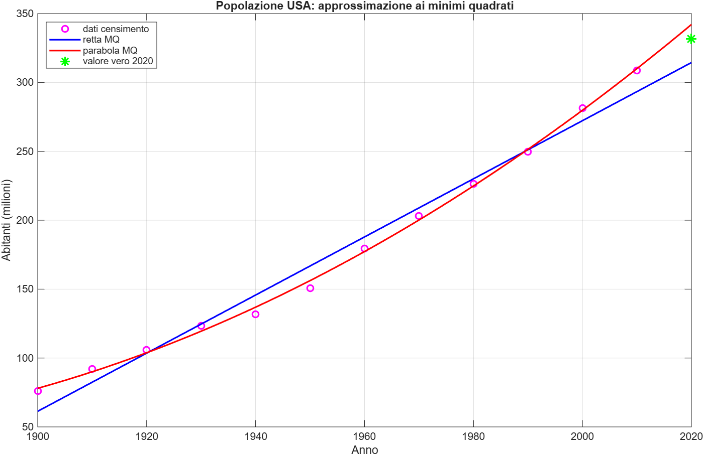
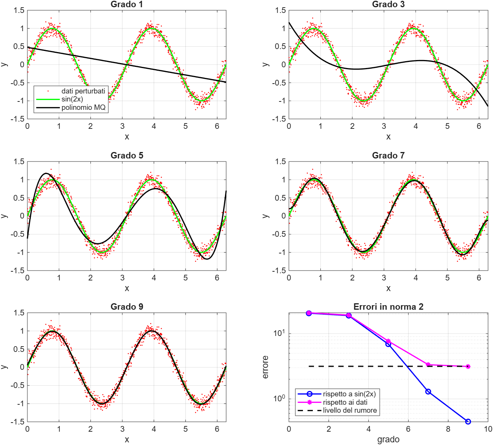
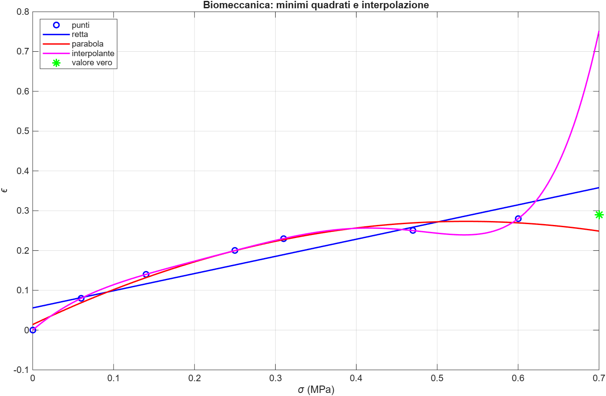

# 📈 Laboratorio 4 — Approssimazione ai minimi quadrati

> 📚 Corso di **Analisi Numerica** — Laurea Triennale in Intelligenza Artificiale e Data Analytics, Università di Trieste (A.A. 2026–2027)

In questo laboratorio si approssimano dei dati con **polinomi ai minimi quadrati**: invece di passare esattamente per tutti i punti (come l'interpolazione), si cerca il polinomio di **grado basso** che ne coglie meglio l'andamento. Si vede come usarlo per fare **previsioni**, per **filtrare il rumore** e perché, con dati sperimentali, l'**interpolazione** può dare risultati pessimi.

---

## 📂 Struttura della cartella

| File | Tipo | Descrizione |
|---|---|---|
| `script_census2020.m` | 📜 script | Popolazione USA 1900–2010: retta e parabola ai minimi quadrati, previsione per il 2020 |
| `script_senoperturbata.m` | 📜 script | Ricostruzione di $\sin(2x)$ da 1000 dati con rumore, polinomi di grado 1, 3, 5, 7, 9 |
| `script_biomeccanica.m` | 📜 script | Esercizio proposto (slide 11): sforzo/deformazione, retta e parabola, stima di $\varepsilon(0.7)$ |
| `script_biomeccanica_interp.m` | 📜 script | Esercizio proposto (slide 12): aggiunta del polinomio interpolante e confronto |
| `img/` | 🖼️ output | Grafici generati dagli script (usati in questo README) |

> ℹ️ In questo laboratorio non ci sono function da scrivere: si usano le function di MATLAB `polyfit` e `polyval`.

---

## 🧠 Un minimo di teoria

### 📏 Il problema dei minimi quadrati
Dati $n$ punti $(x_i, y_i)$, si cerca il polinomio $p_m$ di grado $m$ (tipicamente $m \ll n$) che rende **minima** la somma dei quadrati degli scarti:

$$
\min_{a_0, \dots, a_m} \sqrt{\sum_{i=1}^{n} \big(y_i - (a_0 + a_1 x_i + \dots + a_m x_i^m)\big)^2}
$$

Questo polinomio **esiste ed è unico**. In forma matriciale è il sistema **sovradeterminato** $V\mathbf{a} = \mathbf{y}$ (più equazioni che incognite, con $V_{i,j} = x_i^{\,j}$), risolto nel senso che $\lVert V\mathbf{a} - \mathbf{y} \rVert_2$ sia minima: in generale non ha soluzione esatta.

### 🛠️ In MATLAB

| Comando | Cosa fa |
|---|---|
| `a = polyfit(x, y, m)` | coefficienti del polinomio ai minimi quadrati di grado `m` (dal grado più alto al più basso) |
| `polyval(a, xx)` | valuta il polinomio nei punti `xx` |
| `norm(polyval(a, x) - y)` | errore nei dati, cioè la quantità minimizzata |

### 🔗 Minimi quadrati e interpolazione
Se il grado è $m = n - 1$, il polinomio passa per **tutti** gli $n$ punti: l'errore nei dati è zero, quindi l'**interpolante** è anche il polinomio ai minimi quadrati di grado $n-1$. In MATLAB: `polyfit(x, y, n-1)`.

⚠️ Errore zero sui dati **non** significa buon modello: con dati sperimentali (cioè con **rumore**) l'interpolante insegue anche gli errori di misura, oscilla ed esplode fuori dall'intervallo dei dati. I minimi quadrati di grado basso invece **filtrano** il rumore.

---

## 📝 Esercizi

> In ogni esercizio l'errore nei dati è $\sqrt{\sum_i \big(p(x_i) - y_i\big)^2}$, calcolato con `norm(polyval(a, x) - y)`.

### 1️⃣ Popolazione degli Stati Uniti — `script_census2020.m`

> ❓ **Domanda.** A partire dai dati dei censimenti dal 1900 al 2010, stimare con la retta e con la parabola ai minimi quadrati il numero di abitanti nel 2020 e confrontarlo con il valore del censimento, 331.449.281 abitanti. *(slide 6)*

📊 **Risultati:**

| Polinomio MQ | Errore nei dati | Previsione 2020 | Errore relativo |
|---|---|---|---|
| Retta (grado 1) | 34.8095 | 314.4433 mln | 5.13 % |
| Parabola (grado 2) | 10.3189 | 342.0464 mln | 3.20 % |
| Censimento 2020 | – | 331.4490 mln | – |

💬 **Risposta.** La **retta** sottostima la popolazione del 2020 di circa il 5%, la **parabola** la sovrastima di circa il 3%. La parabola è il modello migliore: approssima meglio i dati (errore 10.3 contro 34.8) e dà una previsione più vicina al valore vero.

Il motivo si vede nel grafico: la retta sbaglia in modo **sistematico** (sta sotto i dati agli estremi e sopra nella parte centrale), segno che il modello lineare è troppo semplice. La crescita della popolazione infatti **accelera**, e la parabola ne coglie la curvatura. Il valore vero del 2020 cade tra le due curve, più vicino alla parabola.



---

### 2️⃣ Ricostruzione di $\sin(2x)$ da dati perturbati — `script_senoperturbata.m`

> ❓ **Domanda.** Dati 1000 campioni di $\sin(2x)$ in $[0, 2\pi]$ perturbati da un rumore gaussiano di ampiezza 0.1, si vuole ricostruire $\sin(2x)$ (e non la funzione perturbata) con polinomi ai minimi quadrati di grado 1, 3, 5, 7, 9. Perché non ha senso usare un polinomio interpolante? Come si comportano gli errori al crescere del grado? *(slide 7–9)*

📊 **Risultati:**

| Grado | Norma 2 vs $\sin(2x)$ | Norma 2 vs dati | Norma ∞ vs $\sin(2x)$ | Norma ∞ vs dati |
|---|---|---|---|---|
| 1 | 2.06e+01 | 2.09e+01 | 1.13e+00 | 1.32e+00 |
| 3 | 1.89e+01 | 1.92e+01 | 1.17e+00 | 1.35e+00 |
| 5 | 6.87e+00 | 7.65e+00 | 7.00e-01 | 8.14e-01 |
| 7 | 1.29e+00 | 3.34e+00 | 2.05e-01 | 4.03e-01 |
| 9 | 4.46e-01 | 3.14e+00 | 5.59e-02 | 3.35e-01 |

*Norma 2 del rumore: 3.16 (≈ $\sqrt{1000} \cdot 0.1$). Generatore casuale fissato con `rng(0)`, così i risultati sono riproducibili.*

💬 **Risposta.**

🚫 **Perché non l'interpolazione.** Un polinomio interpolante (o una spline interpolante) passa esattamente per tutti i punti, quindi ricostruirebbe la funzione **perturbata**, rumore compreso. A noi interessa invece la funzione vera $\sin(2x)$, cioè l'andamento "medio" dei dati.

📉 **Comportamento degli errori.**
- **Gradi 1 e 3:** errori grandi (~20) sia rispetto ai dati sia rispetto a $\sin(2x)$: il polinomio è troppo semplice per seguire due oscillazioni.
- **Grado 5:** segue le oscillazioni ma sbaglia le ampiezze e si allontana agli estremi dell'intervallo.
- **Gradi 7 e 9:** l'errore rispetto a $\sin(2x)$ continua a scendere (0.446 al grado 9, e appena 0.056 in norma ∞), mentre l'errore rispetto ai dati si ferma a 3.14, praticamente la norma del rumore (3.16).

Quindi il polinomio ai minimi quadrati di grado basso (9, contro 1000 punti) **non insegue il rumore ma lo filtra**: ricostruisce la funzione vera e scarta la perturbazione. L'errore rispetto ai dati non può scendere sotto il livello del rumore senza che il polinomio cominci a "imparare" il rumore stesso.



---

### 3️⃣ Biomeccanica: retta e parabola — `script_biomeccanica.m`

🎯 Dati sperimentali di sforzo $\sigma$ (MPa) e deformazione $\varepsilon$ di un disco intervertebrale; si vuole stimare $\varepsilon(0.7)$, sapendo che il valore osservato è 0.29. *(slide 11)*

| $\sigma$ (MPa) | 0 | 0.06 | 0.14 | 0.25 | 0.31 | 0.47 | 0.60 |
|---|---|---|---|---|---|---|---|
| $\varepsilon$ | 0 | 0.08 | 0.14 | 0.20 | 0.23 | 0.25 | 0.28 |

> 💡 Nello script il vettore delle deformazioni si chiama `defo` e non `eps`, perché `eps` in MATLAB è la precisione di macchina.

#### 📏 Punto 1 — Retta ai minimi quadrati

> ❓ **Domanda.** Approssimare i dati con la retta ai minimi quadrati e stimare $\varepsilon(0.7)$.

💬 **Risposta.** La retta è $\varepsilon(\sigma) = 0.4317\,\sigma + 0.0557$ e fornisce $\varepsilon(0.7) = 0.3579$, con uno scarto di 0.068 dal valore osservato 0.29.

#### 📐 Punto 2 — Parabola ai minimi quadrati

> ❓ **Domanda.** Approssimare i dati con la parabola ai minimi quadrati e stimare $\varepsilon(0.7)$.

💬 **Risposta.** La parabola è $\varepsilon(\sigma) = -0.9046\,\sigma^2 + 0.9688\,\sigma + 0.0139$ e fornisce $\varepsilon(0.7) = 0.2488$, con uno scarto di 0.041 dal valore osservato.

#### ⚖️ Punto 3 — Confronto

> ❓ **Domanda.** Rappresentare in un unico grafico i punti, i due polinomi e il punto (0.7, 0.29); calcolare per entrambi la radice della somma dei quadrati degli scarti nei dati. Quale dei due polinomi descrive meglio i dati sperimentali? Si giustifichi bene la risposta.

📊 **Risultati:**

| Polinomio MQ | Errore nei dati | $\varepsilon(0.7)$ | Scarto da 0.29 |
|---|---|---|---|
| Retta (grado 1) | 0.0890 | 0.3579 | 0.0679 |
| Parabola (grado 2) | 0.0297 | 0.2488 | 0.0412 |

💬 **Risposta.** I dati sono descritti meglio dalla **parabola**, per tre motivi:
- ✅ **Errore nei dati 3 volte più piccolo:** 0.0297 contro 0.0890.
- ✅ **Forma corretta:** la deformazione cresce rapidamente all'inizio e poi sempre più lentamente (il tessuto si irrigidisce): un andamento concavo, che la parabola (coefficiente di $\sigma^2$ negativo) riproduce. Gli scarti della retta hanno invece un andamento sistematico: la retta sta sotto i dati nella zona centrale e sopra agli estremi.
- ✅ **Previsione più vicina al vero:** 0.2488 contro 0.3579. Inoltre in $\sigma = 0$ la parabola vale 0.014, vicino al valore fisico 0, mentre la retta vale 0.056.

⚠️ **Attenzione però all'estrapolazione.** La parabola ha il vertice in

$$
\sigma = -\frac{b}{2a} = \frac{0.9688}{2 \cdot 0.9046} \approx 0.535
$$

e da lì in poi **decresce**: fisicamente è impossibile, perché aumentando lo sforzo la deformazione non può diminuire. La stima in $\sigma = 0.7$ cade quindi sul ramo discendente ed è sotto il valore osservato. Dentro l'intervallo dei dati $[0, 0.6]$ la parabola è il modello migliore, ma nessuno dei due polinomi è affidabile per stime lontane dai dati.



---

### 4️⃣ Biomeccanica: polinomio interpolante — `script_biomeccanica_interp.m`

#### 🔢 Punti 1 e 2 — Interpolante e stima di $\varepsilon(0.7)$

> ❓ **Domanda.** Modificare lo script precedente per calcolare il polinomio di interpolazione che passa per i punti della tabella e stimare con esso $\varepsilon(0.7)$. *(slide 12)*

💬 **Risposta.** Con 7 punti il polinomio interpolante ha grado 6 e si ottiene con `polyfit(sigma, defo, n-1)` (slide 10): passando per tutti i punti, il suo errore nei dati è nullo, e quindi è anche il polinomio ai minimi quadrati di grado 6.

📊 **Risultati:**

| Polinomio | Errore nei dati | $\varepsilon(0.7)$ | Scarto da 0.29 |
|---|---|---|---|
| Retta MQ (grado 1) | 8.90e-02 | 0.3579 | 0.0679 |
| Parabola MQ (grado 2) | 2.97e-02 | 0.2488 | 0.0412 |
| Interpolante (grado 6) | 1.72e-15 | **0.7519** ❌ | **0.4619** |

#### 🤔 Punto 3 — Il valore è accettabile?

> ❓ **Domanda.** Includere nel grafico anche il polinomio di interpolazione. È accettabile il valore previsto usando l'interpolante?

💬 **Risposta.** **No.** L'interpolante prevede $\varepsilon(0.7) = 0.7519$ contro il valore osservato 0.29: sbaglia di 0.46, cioè di circa il 160%, molto più della retta e della parabola. Eppure il suo errore nei dati è praticamente zero ($1.72 \cdot 10^{-15}$). Le ragioni:
- 🎯 **Insegue gli errori di misura:** passando esattamente per ogni punto sperimentale, si adatta anche alle piccole imprecisioni dei dati (lo stesso fenomeno dell'esercizio 2, dove i minimi quadrati filtravano il rumore e l'interpolazione lo avrebbe ricostruito).
- 〰️ **Oscilla tra i nodi:** tra $\sigma = 0.47$ e $\sigma = 0.60$ la curva scende fino a circa 0.24, sotto il dato 0.25, anche se la deformazione dovrebbe crescere.
- 💥 **Esplode fuori dai dati:** un polinomio di grado 6 con coefficienti grandi (il termine principale è circa $87\,\sigma^6$) cresce rapidissimo appena si esce dall'intervallo $[0, 0.6]$: a $\sigma = 0.7$ la curva è già a 0.75.

Conclusione: un errore nullo sui dati **non** garantisce un buon modello. Per dati sperimentali, e soprattutto per fare previsioni, è preferibile un polinomio di **grado basso ai minimi quadrati**, che coglie l'andamento generale invece di ogni singolo punto.


---

## 🎯 Concetti chiave da ricordare

- 📏 I minimi quadrati cercano il polinomio di grado $m$ (con $m$ molto minore del numero di dati) che rende minima la somma dei quadrati degli scarti: non passa per i punti, ma ne coglie l'andamento.
- 🔍 Se gli scarti hanno un andamento **sistematico** (sempre sopra in una zona, sempre sotto in un'altra), il modello è troppo semplice per i dati.
- 🔮 Un errore piccolo nei dati aiuta a prevedere solo se il modello ha la forma giusta (censimento: la parabola segue la crescita che accelera).
- 🔇 Con dati affetti da rumore, i minimi quadrati di grado basso **filtrano** il rumore; l'interpolazione invece lo **riproduce**.
- ⚠️ L'**estrapolazione**, cioè la stima fuori dall'intervallo dei dati, è sempre delicata: i polinomi di grado alto oscillano ed esplodono, e anche quelli di grado basso possono avere un andamento fisicamente sbagliato (il ramo discendente della parabola).

---

## ▶️ Come eseguire

1. Apri MATLAB e imposta questa cartella come **Current Folder**
2. Lancia uno script dalla Command Window, ad esempio:

```matlab
>> script_census2020
>> script_senoperturbata
>> script_biomeccanica
>> script_biomeccanica_interp
```

Ogni script stampa i risultati in colonne, apre il grafico e lo salva in `img/` 📊. `script_senoperturbata` riempie i 6 riquadri uno alla volta, con una pausa di 2 secondi tra un grado e l'altro.